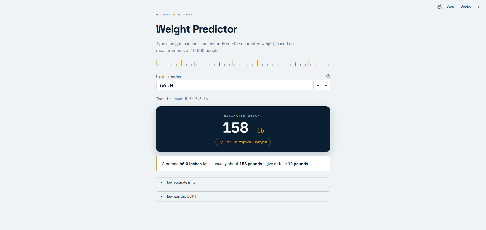

# Weight Predictor

A friendly Streamlit app that estimates a person's **weight (pounds)** from their **height (inches)** — built for non-technical users: type a number, get an answer.



Based on the classic `weight-height` dataset (10,000 people) and the workflow from **Practical 7B** (multiple linear-regression models), retrained to beat the practical's reported score.

## Try it

```bash
git clone https://github.com/Pranjal180206/height-weight-predictor.git
cd height-weight-predictor
pip install -r requirements.txt
streamlit run app.py
```

Then open http://localhost:8501, type a height between 54 and 79 inches, and read the estimate.

## What the app shows

- **Scale-style readout** — big estimated weight with the typical margin (+/- 12 lb)
- **Plain-English sentence** — "A person 66.0 inches tall is usually about 158 pounds — give or take 12 pounds"
- **Feet & inches helper** — so 66 in also reads as "5 ft 6.0 in"
- **How accurate is it?** — accuracy explained without jargon
- **How was this built?** — the practical's workflow in plain words
- **Compare all 5 models** — full metric table for the curious

## Model performance

Same protocol as Practical 7B (80/20 split, `random_state=42`, `StandardScaler`), but with tuned hyperparameters and polynomial features:

| Model family | Best R² | Practical 7B baseline |
|---|---|---|
| **Linear (degree-3 polynomial)** | **0.8604** | 0.8577 |
| Random Forest (depth 5) | 0.8588 | 0.8469 |
| Decision Tree (depth 5) | 0.8578 | 0.8345 |
| Lasso | 0.8577 | 0.8577 |
| Ridge | 0.8577 | 0.8577 |

- **Winner:** polynomial (degree 3) linear regression on height — `R² = 0.8604`, RMSE ≈ 12.1 lb
- The best model is saved as a scikit-learn `Pipeline` (preprocessing travels with the model — no manual scaling needed at prediction time)

## Project structure

```
├── app.py               # Streamlit app (the whole UI)
├── best_model.pkl       # trained pipeline (winner of the model comparison)
├── scaler.pkl           # fitted StandardScaler from the best pipeline
├── model_results.json   # test metrics for all 5 model families (shown in the app)
├── requirements.txt     # dependencies
├── .streamlit/config.toml  # light theme + app settings
├── assets/image.png     # app screenshot
└── .gitignore
```

## Tech stack

Python 3.14 · Streamlit · scikit-learn · pandas · numpy · joblib

## Notes

- Units are **inches** and **pounds**, matching the dataset
- The model only works for heights between **54 and 79 inches** (its training range)
- Accuracy figure (`R² ≈ 0.86`) means the model explains about 86% of the weight differences between people; individual predictions are typically within about ±12 lb
